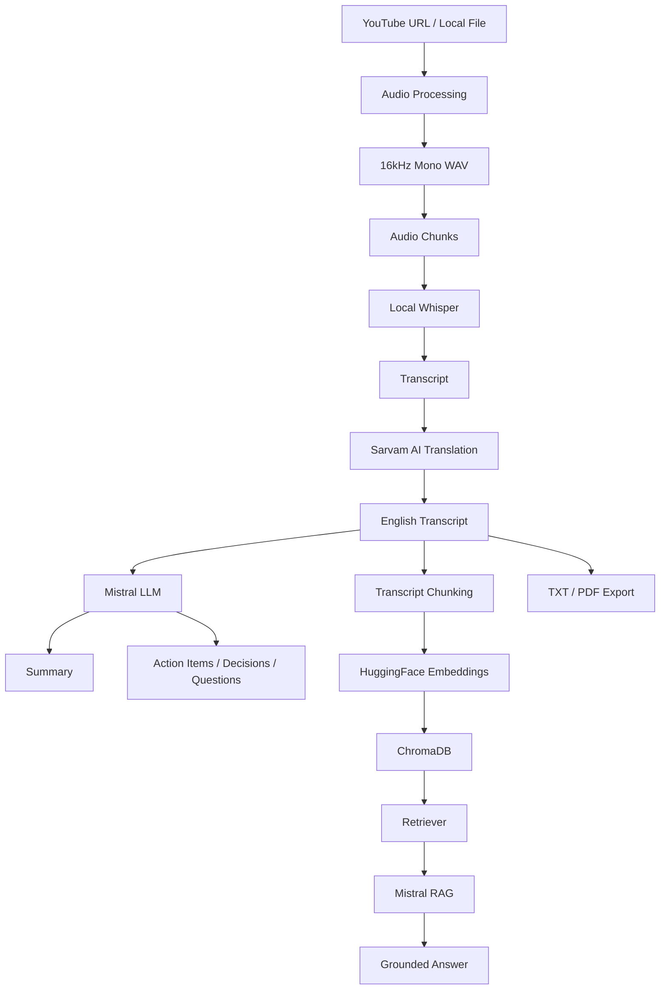

# AI Video Assistant with RAG

A modular, production-ready video intelligence and meeting assistant that transforms long videos and meetings into structured transcripts, actionable insights, and a searchable vector knowledge base.

---

## Overview

### The Problem
Long videos, recorded meetings, and tutorials contain high-value knowledge, but manually reviewing, summarizing, and searching through hours of spoken content is time-consuming and inefficient.

### The Solution
This application processes video and audio from YouTube URLs or local media uploads to produce:
1. An accurate English transcript (with optional Hindi/Hinglish translation).
2. A structured multi-section summary.
3. Extracted meeting insights (action items, key decisions, open questions).
4. An isolated ChromaDB vector index for Retrieval-Augmented Generation (RAG) that answers questions strictly from the video content.
5. Downloadable reports in TXT and styled PDF formats.

---

## Features

- **Multi-Source Ingestion:** Accepts YouTube URLs (via `yt-dlp`) and local audio/video uploads (`.mp4`, `.mkv`, `.mov`, `.webm`, `.mp3`, `.wav`, `.m4a`, `.flac`).
- **Audio Extraction & Normalization:** Converts audio tracks to standardized 16kHz mono WAV format using FFmpeg and Pydub.
- **Chunked Processing:** Splits audio into configurable 10-minute chunks for reliable processing without memory exhaustion.
- **Local Speech Transcription:** Utilizes OpenAI Whisper locally (CPU or CUDA GPU).
- **Regional Language Translation:** Translates Hindi and Hinglish transcripts to clean English using Sarvam AI (`mayura:v1`).
- **Map-Reduce Summarization:** Produces detailed summaries (Overview, Key Themes, Discussion Points, Takeaways) using Mistral and LangChain.
- **Structured Insight Extraction:** Extracts actionable tasks (Task, Owner, Deadline), Key Decisions, and Open Questions using Pydantic schemas.
- **Local Vector Embeddings:** Embeds transcript segments using HuggingFace `sentence-transformers/all-MiniLM-L6-v2` locally.
- **Session-Isolated Vector Store:** Manages separate ChromaDB collections per video to prevent context cross-contamination.
- **Grounded Transcript Q&A (RAG):** Context-constrained LCEL retrieval chain that answers user queries based solely on retrieved video segments.
- **Export Options:** Generates clean transcript text files, summary text files, and multi-page styled PDF reports via ReportLab.
- **Streamlit Web UI:** Clean tabbed interface with real-time processing indicators and chat history.

---

## Architecture



---

## Tech Stack

| Category | Technologies |
| :--- | :--- |
| **Language & Runtime** | Python 3.10+ (tested on Python 3.13.5) |
| **User Interface** | Streamlit |
| **Speech-to-Text** | OpenAI Whisper (Local) |
| **Translation** | Sarvam AI (`mayura:v1` API) |
| **LLM & Reasoning** | Mistral AI (`open-mistral-7b` / configurable via API) |
| **Orchestration & RAG**| LangChain, LangChain Core, LangChain MistralAI |
| **Embeddings** | HuggingFace (`sentence-transformers/all-MiniLM-L6-v2`) |
| **Vector Database** | ChromaDB (`langchain-chroma`) |
| **Media Processing** | FFmpeg, Pydub, yt-dlp |
| **Document Generation**| ReportLab (PDF), UTF-8 text exporters |
| **Validation** | Pydantic v2 |

---

## Project Structure

```text
AI Video Assistant with RAG/
├── core/
│   ├── transcriber.py          # Local Whisper transcription pipeline
│   ├── translate.py            # Sarvam AI translation with sentence-boundary chunking
│   ├── summarizer.py           # Map-Reduce & direct Mistral summarization
│   ├── extractor.py            # Pydantic-validated insights extraction
│   ├── vector_store.py         # ChromaDB management & isolated vector collections
│   ├── rag_engine.py           # LCEL RAG chain with strict grounding prompt
│   └── pipeline.py             # End-to-end orchestration pipeline
├── utils/
│   ├── audio_preprocessors.py   # yt-dlp downloading, WAV conversion & chunking
│   └── exporters.py            # TXT & ReportLab PDF report generation
├── tests/
│   ├── test_translate.py       # Translation & text chunking tests
│   ├── test_summarizer.py      # Transcript splitting tests
│   ├── test_extractor.py       # Pydantic schema validation tests
│   ├── test_vector_store.py    # Vector store persistence & isolation tests
│   ├── test_rag.py             # RAG grounding & context relevance tests
│   ├── test_pipeline.py        # Orchestration & stage sequencing tests
│   └── test_app_helpers.py     # PDF & TXT export helper tests
├── docs/
│   └── screenshots/            # Application UI screenshots
├── app.py                      # Streamlit web application
├── requirements.txt            # Dependency manifest
├── .env.example                # Configuration template
├── .gitignore                  # Git ignore rules
└── README.md
```

### Module Roles
- **`core/pipeline.py`**: Central coordinator that executes stages sequentially, manages intermediate caching, and reports stage progress.
- **`core/transcriber.py`**: Loads the local Whisper model and transcribes audio chunks.
- **`core/translate.py`**: Chunks transcripts along sentence boundaries and calls Sarvam AI translation.
- **`core/summarizer.py`**: Implements map-reduce summarization to handle long transcripts within model context limits.
- **`core/extractor.py`**: Employs structured JSON schema outputs to extract action items, decisions, and questions.
- **`core/vector_store.py`**: Chunks transcript text, calculates embeddings, and creates isolated Chroma collections.
- **`core/rag_engine.py`**: Retrieves relevant chunks and applies a strict grounding prompt with Mistral.
- **`utils/audio_preprocessors.py`**: Handles media downloading, FFmpeg conversions to 16kHz mono WAV, and segment splitting.
- **`utils/exporters.py`**: Generates clean TXT artifacts and multi-section ReportLab PDF reports.
- **`app.py`**: Presentation layer for user interactions, tabbed navigation, and chat interface.

---

## How It Works

1. **Media Ingestion:** The user supplies a YouTube URL or uploads a local media file.
2. **Audio Conversion:** The audio track is extracted and normalized into a single-channel 16kHz WAV file.
3. **Audio Chunking:** Long audio files are sliced into 10-minute segments to optimize Whisper throughput.
4. **Transcription:** Local Whisper transcribes each segment into text.
5. **Translation (Optional):** Hindi or Hinglish spoken content is translated to English via Sarvam AI.
6. **Summarization:** Mistral generates a structured multi-part summary using map-reduce when transcript length exceeds context thresholds.
7. **Insight Extraction:** Key tasks (with owners and deadlines), decisions, and open questions are extracted into structured objects.
8. **Vector Indexing:** The transcript is split into overlapping chunks, vectorized with `all-MiniLM-L6-v2`, and indexed in ChromaDB.
9. **Grounded Q&A:** When a user queries the video, top relevant chunks are retrieved and provided to Mistral with strict instructions to answer only from context.

---

## Retrieval-Augmented Generation (RAG) Details

The RAG subsystem is designed around grounded retrieval:
- **Chunking Strategy:** `RecursiveCharacterTextSplitter` configured with a chunk size of 800 characters and 120-character overlap.
- **Local Embeddings:** `sentence-transformers/all-MiniLM-L6-v2` runs locally without external API latency or cost.
- **Isolation:** Each processed video receives its own collection name (`vid_<video_id>`) in ChromaDB, preventing cross-video context mixing.
- **Strict Grounding Prompt:** The prompt instructs Mistral to rely strictly on the provided context chunks. If the answer cannot be found in the retrieved chunks, it outputs:
  > *"I couldn't find that information in the transcript."*
- **Tested Verification:** Verified with both factual questions (grounded answers returned with source chunk references) and unmentioned questions (rejected without hallucinating).

---

## Installation & Setup

### Prerequisites
- Python 3.10 to 3.13
- FFmpeg installed and available on your system `PATH`

#### Installing FFmpeg on Windows
Using `winget` (Windows Package Manager):
```powershell
winget install Gyan.FFmpeg
```
*Alternatively, download from [gyan.dev/ffmpeg](https://www.gyan.dev/ffmpeg/builds/) and add the `bin` directory to your system `PATH`.*

Verify FFmpeg installation:
```powershell
ffmpeg -version
```

### Option A: Using `uv` (Recommended)
```powershell
# Create and activate virtual environment
uv venv .venv
.\.venv\Scripts\activate

# Install dependencies
uv pip install -r requirements.txt
```

### Option B: Using standard `venv` & `pip`
```powershell
# Create and activate virtual environment
python -m venv .venv
.\.venv\Scripts\activate

# Install dependencies
pip install -r requirements.txt
```

---

## Configuration

Copy `.env.example` to create your `.env` file:
```powershell
copy .env.example .env
```

Set your configuration keys:
```env
# Mistral API Key (from https://console.mistral.ai/)
MISTRAL_API_KEY=your_mistral_api_key

# Mistral Model ('open-mistral-7b' recommended for free/standard tiers)
MISTRAL_MODEL=open-mistral-7b

# Sarvam AI API Key (from https://sarvam.ai/)
SARVAM_API_KEY=your_sarvam_api_key

# Whisper Model ('tiny', 'base', 'small', 'medium', 'large')
WHISPER_MODEL=small
```

> [!WARNING]
> Never commit `.env` or hardcode API keys in source files.

---

## Running the Application

Launch the Streamlit interface:
```powershell
streamlit run app.py
```

### Step-by-Step Usage:
1. Select **YouTube URL** or **Upload File**.
2. Paste the URL or upload your audio/video file.
3. Click **🚀 Process Video** and follow real-time progress indicators.
4. Explore tabs:
   - **📌 Overview:** Video metadata and high-level metrics.
   - **📜 Transcript:** Complete formatted English transcript.
   - **📝 Summary:** Structured takeaways and key themes.
   - **✅ Action Items / 🎯 Decisions / ❓ Questions:** Tabular and structured insights.
   - **💬 Ask the Video:** Interactive grounded Q&A chat.
   - **📦 Export:** Download TXT transcripts, TXT summaries, or full styled PDF reports.

---

## Automated Testing

Run the automated test suite with `pytest`:
```powershell
pytest -v
```

**Verified Test Baseline:**
```text
24 passed in ~30s
- tests/test_translate.py      (3 tests)
- tests/test_summarizer.py     (3 tests)
- tests/test_extractor.py      (1 test)
- tests/test_vector_store.py   (5 tests)
- tests/test_rag.py            (4 tests)
- tests/test_pipeline.py       (4 tests)
- tests/test_app_helpers.py    (4 tests)
```

---

## Performance Example

The following timing measurements were recorded during a local 2-minute test run (`test_sample_2min.mp4`):

| Pipeline Stage | Measured Duration |
| :--- | :--- |
| Audio conversion | ~0.66s |
| Whisper transcription (`small` model, CPU) | ~47.46s |
| Sarvam translation | ~4.45s |
| Mistral summarization (`open-mistral-7b`) | ~7.31s |
| Insight extraction (`open-mistral-7b`) | ~1.99s |
| Vector indexing (ChromaDB + MiniLM) | ~10.86s |

*Note: These measurements are from one local 2-minute test run and should not be treated as universal benchmarks. Processing times scale with media duration, hardware specifications, and network latency.*

---

## Known Limitations

- **Compute Demands:** Local Whisper transcription on CPU scales with audio length; GPU acceleration (`CUDA`) is recommended for longer videos.
- **Provider Rate Limits:** Mistral AI free tiers may enforce rate limits on larger models (such as `mistral-small-latest`); `open-mistral-7b` is configured as the default to prevent quota rejections.
- **Translation Fidelity:** Sarvam translation accuracy depends on the acoustic clarity and transcription quality of the initial Whisper output.
- **Speaker Diarization:** Speaker attribution (identifying who spoke which sentence) is not currently implemented.
- **Single Active Session:** The current Streamlit session state is designed around analyzing one active video at a time.

---

## Demo

Screenshots and interface captures can be added to the [`docs/screenshots/`](docs/screenshots/) folder:
- `docs/screenshots/dashboard.png`
- `docs/screenshots/transcript.png`
- `docs/screenshots/insights.png`
- `docs/screenshots/rag-chat.png`

---

## License

This project is licensed under the [MIT License](LICENSE).
